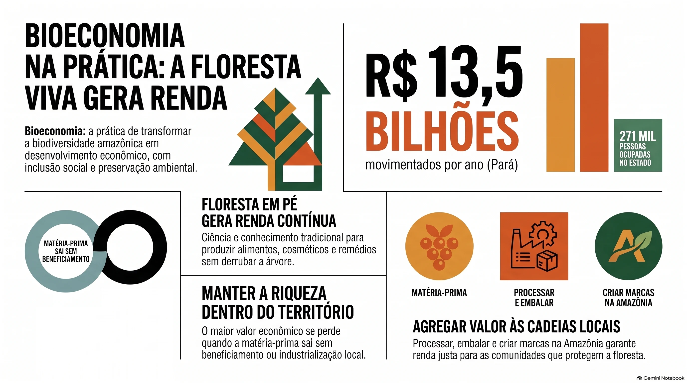
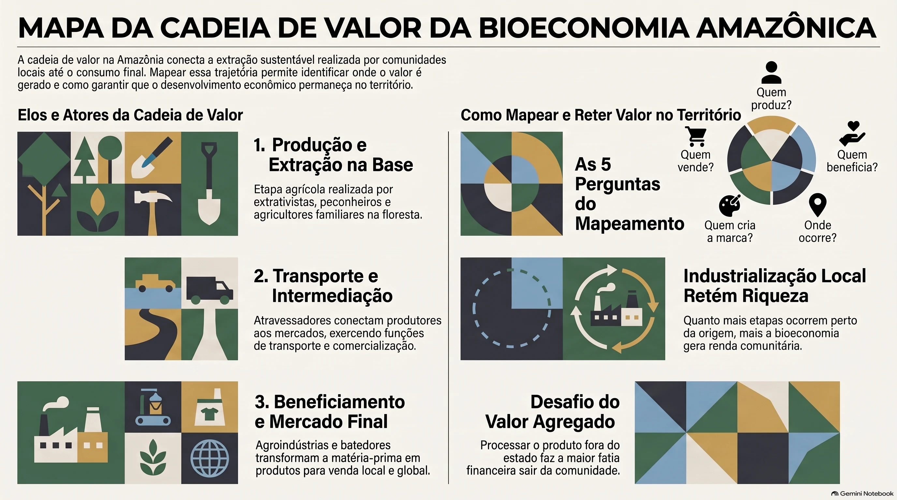

_Saiu do discurso de evento e virou lei, plano nacional e pauta global. Entenda o conceito em linguagem de gente e por que ele importa para quem vive na região._

Em Limoeiro do Ajuru, no Baixo Tocantins, o dia de muita gente começa subindo em açaizeiro. Em Óbidos, no Baixo Amazonas, a safra da castanha organiza o calendário de famílias inteiras. Na Transamazônica, entre Medicilândia e Uruará, o cacau cresce à sombra de outras árvores. Nenhuma dessas pessoas acorda pensando "hoje vou fazer bioeconomia". Mas é exatamente isso que fazem.

A palavra virou figurinha carimbada em painel, edital e discurso de autoridade, principalmente depois da COP30 em Belém. E quando uma palavra aparece demais, ela corre o risco de não significar nada. Este artigo existe para resolver isso: explicar o que é bioeconomia, de onde o conceito veio, o que a lei brasileira diz sobre ele e por que quem vive na Amazônia tem tudo a ver com essa conversa.

<Secao tom="verde" de="base">

## O cenário em números

### Virou política de Estado

O Decreto nº 12.044, de 5 de junho de 2024, instituiu a Estratégia Nacional de Bioeconomia. Em 1º de abril de 2026, o governo federal lançou o Plano Nacional de Desenvolvimento da Bioeconomia (PNDBio), construído com 16 ministérios, a Embrapa e organizações da sociedade.

<Kpis>
  <Kpi valor="21" rotulo="metas no PNDBio" />
  <Kpi valor="185" rotulo="ações previstas" />
  <Kpi valor="16" rotulo="ministérios envolvidos" />
  <Kpi valor="R$ 350 mi" rotulo="do Fundo Amazônia anunciados" detalhe="bioeconomia e inovação na região" />
</Kpis>

### Virou pauta global

Em setembro de 2024, sob a presidência brasileira do G20, os países do grupo aprovaram dez princípios de alto nível sobre bioeconomia, um deles dedicado aos direitos e ao conhecimento tradicional de povos indígenas e comunidades tradicionais.

Em novembro de 2025, a COP30 em Belém lançou o Fundo Florestas Tropicais para Sempre (TFFF), mecanismo para remunerar países que mantêm a floresta em pé.

<Kpis>
  <Kpi valor="10" rotulo="princípios aprovados pelo G20" />
  <Kpi valor="US$ 6,7 bi" rotulo="mobilizados pelo TFFF" detalhe="até o fim da COP30, segundo a ANBA" />
</Kpis>

### A floresta já produz riqueza

Segundo a pesquisa de Produção da Extração Vegetal e da Silvicultura (PEVS 2024), do IBGE, o açaí extrativista somou 247,5 mil toneladas em 2024. A castanha-do-pará gerou R$ 195,5 milhões.

<Kpis>
  <Kpi valor="R$ 1 bi" rotulo="em valor de produção do açaí extrativista" detalhe="247,5 mil toneladas" />
  <Kpi valor="R$ 195,5 mi" rotulo="em valor de produção da castanha-do-pará" />
</Kpis>

<GraficoRosca
  titulo="Açaí extrativista: o peso do Pará"
  valor={68.1}
  rotulo="do volume nacional vem do Pará"
  restante="resto do Brasil"
  fonte="IBGE, PEVS 2024"
/>

<GraficoBarras
  titulo="Quem colhe o açaí do país (% do volume nacional)"
  dados={[
    { rotulo: "Pará", valor: 68.1 },
    { rotulo: "Limoeiro do Ajuru (PA), sozinho", valor: 20.2, alt: true },
  ]}
  max={100}
  sufixo="%"
  fonte="IBGE, PEVS 2024"
/>

### No Pará, a conta é ainda maior

Um relatório preliminar coordenado pela Fapespa com UFPA, Ufopa e Unifesspa, divulgado em maio de 2026, estimou o tamanho da bioeconomia da sociobiodiversidade no estado.

<Kpis>
  <Kpi valor="R$ 13,5 bi" rotulo="movimentados por ano no Pará" />
  <Kpi valor="271 mil" rotulo="pessoas ocupadas" />
</Kpis>

<GraficoBarras
  titulo="As cadeias que mais movimentam (R$ bilhões por ano)"
  dados={[
    { rotulo: "Mandioca", valor: 6.5 },
    { rotulo: "Pesca e aquicultura", valor: 2.7 },
    { rotulo: "Cacau", valor: 1.7 },
    { rotulo: "Açaí", valor: 1.5 },
  ]}
  prefixo="R$ "
  sufixo=" bi"
  fonte="Fapespa, UFPA, Ufopa e Unifesspa (relatório preliminar, maio de 2026)"
/>

### E o horizonte é maior ainda

O estudo _Nova Economia da Amazônia_, do WRI Brasil, publicado em 2023, segue sendo a principal referência de projeção para a região. Ele estima o que uma economia baseada na floresta em pé pode render até 2050, em comparação com o caminho atual.

<Kpis>
  <Kpi valor="+R$ 40 bi" rotulo="no PIB da Amazônia Legal em 2050" />
  <Kpi valor="+312 mil" rotulo="empregos a mais do que o caminho atual" />
</Kpis>

</Secao>

<Secao tom="marfim" de="verde">

## A teoria por trás

Três ideias, de três épocas, explicam de onde veio a bioeconomia que a lei brasileira hoje define.

<Marcos
  itens={[
    { ano: "1971", titulo: "A economia tem limites", texto: "Georgescu-Roegen: a economia depende da natureza e desgasta o sistema a cada ciclo." },
    { ano: "2009", titulo: "O olhar de mercado", texto: "OCDE: bioeconomia como biotecnologia, a partir dos laboratórios de países ricos." },
    { ano: "2016", titulo: "A terceira via", texto: "Carlos Nobre: valor com a floresta viva, entre intocar e derrubar." },
    { ano: "2024", titulo: "A lei brasileira", texto: "Decreto nº 12.044 junta as peças e acrescenta justiça, ética e inclusão." },
  ]}
/>

### Georgescu-Roegen: a economia também obedece à natureza

O economista romeno Nicholas Georgescu-Roegen publicou em 1971 _The Entropy Law and the Economic Process_. A provocação dele era simples e incômoda: a economia não é uma máquina que gira sozinha num papel. Ela retira matéria e energia da natureza e devolve resíduos. Cada ciclo desgasta um pouco o sistema. Ignorar isso é como gastar a poupança achando que é salário. A partir dessa crítica, ele passou a defender uma "bioeconomia", isto é, uma economia que reconhece os limites biológicos e físicos do planeta.

### Carlos Nobre e a terceira via para a Amazônia

Em 2016, o climatologista Carlos Nobre e outros pesquisadores publicaram na revista científica PNAS um artigo que virou referência. Eles mostram que a Amazônia esteve presa entre duas ideias: deixar a floresta intocada ou derrubá-la para dar lugar a pasto e grãos. E propõem uma **terceira via**: usar ciência, tecnologia e conhecimento tradicional para gerar valor com produtos da floresta viva. Na prática, isso significa entender o açaí, o cacau, os óleos e as sementes como base de indústrias inteiras, e não como "produto exótico".

### A OCDE e o olhar de mercado

Em 2009, a OCDE publicou _The Bioeconomy to 2030_, um relatório que olhava a bioeconomia principalmente pela lente da biotecnologia: produzir alimentos, remédios e materiais a partir de processos biológicos. É uma visão importante, mas pensada a partir dos laboratórios de países ricos.

### A definição brasileira

A definição do Decreto nº 12.044 junta essas peças e acrescenta algo que faz toda a diferença. Bioeconomia é um modelo de desenvolvimento "baseado em valores de justiça, ética e inclusão", que gera produtos, processos e serviços com base no uso sustentável, na regeneração e na conservação da biodiversidade.

<Destaque titulo="Resumindo com uma analogia de quintal">
  A economia tradicional derruba a mangueira para vender a madeira uma vez. A bioeconomia cuida da mangueira, vende manga todo ano, faz polpa, doce e sorvete, e ainda garante sombra para a casa. A diferença é que, na Amazônia, o quintal é do tamanho de um continente e os saberes sobre ele são milenares.
</Destaque>

</Secao>

<Secao tom="roxo" de="marfim">

## Na prática

### Bioeconomia no seu dia a dia

Você provavelmente já consome e talvez já trabalhe com bioeconomia:

- **Alimentos:** açaí, castanha, cupuaçu, cacau, farinha, tucupi, jambu, mel de abelhas nativas, peixe manejado.
- **Cosméticos e bem-estar:** andiroba, copaíba, murumuru, buriti, ucuuba.
- **Restauração:** sementes nativas coletadas para reflorestar áreas degradadas.
- **Serviços:** turismo de base comunitária, gastronomia regional, pesquisa, design e comunicação de produtos da floresta.

### Por que isso importa para quem vive aqui

Por três motivos bem concretos:

1. **É renda que não depende de derrubar.** A floresta em pé passa a valer mais do que a floresta no chão.
2. **É onde estão os investimentos e as políticas.** PNDBio, Fundo Amazônia e o TFFF apontam recursos para cadeias da sociobiodiversidade. Quem entende o tema consegue acessar oportunidades.
3. **É onde está o valor que ainda vai embora.** O mesmo estudo da Fapespa mostra que, em algumas cadeias, o grosso do valor fica com quem industrializa fora do estado.

O caso do cumaru é emblemático:

<GraficoBarras
  titulo="Cumaru: a fatia do coletor no valor final"
  dados={[
    { rotulo: "Etapa inicial, na coleta", valor: 69.9 },
    { rotulo: "Depois da industrialização feita fora do Pará", valor: 23.3, alt: true },
  ]}
  max={100}
  sufixo="%"
  fonte="Fapespa, UFPA, Ufopa e Unifesspa (relatório preliminar, maio de 2026)"
/>

### Um mapa simples para entender uma cadeia

Escolha um produto da sua região e responda:

1. Quem coleta ou planta?
2. Quem beneficia (seca, prensa, despolpa, embala)?
3. Onde isso acontece: na comunidade, na cidade ou fora do estado?
4. Quem dá nome, marca e conta a história do produto?
5. Quem vende para o consumidor final, e por quanto?

Quanto mais etapas acontecem perto de onde o produto nasce, mais a bioeconomia gera desenvolvimento local.

</Secao>

<Secao tom="marfim" de="roxo">

## Dúvidas frequentes

<Duvida pergunta="Bioeconomia é só para grandes empresas e ONGs?">
  Não. A definição legal inclui expressamente povos indígenas, comunidades tradicionais e agricultores familiares. Pequenos negócios, cooperativas e profissionais de comunicação, tecnologia e turismo também fazem parte das cadeias.
</Duvida>

<Duvida pergunta="Bioeconomia e sustentabilidade são a mesma coisa?">
  Não exatamente. Sustentabilidade é um princípio. Bioeconomia é um modelo econômico que tenta colocar esse princípio para funcionar, gerando produtos e renda a partir da biodiversidade conservada.
</Duvida>

<Duvida pergunta="A COP30 já passou. O assunto vai esfriar?">
  Os sinais apontam o contrário: depois da conferência vieram o PNDBio, os recursos do Fundo Amazônia e a ampliação do acompanhamento estatístico de produtos da sociobiodiversidade pelo IBGE, que a partir do ano de referência 2025 passa a medir individualmente buriti, andiroba, murumuru, tucumã, cupuaçu e pupunha.
</Duvida>

</Secao>

<Secao tom="verde" de="marfim">

## O olhar da Ousadia

A gente explica bioeconomia de um jeito que qualquer jovem de 20 anos em Altamira entende: é gerar renda trabalhando com a floresta em pé. Simples assim. O desafio é que, por muito tempo, quem morava na floresta foi tratado como figurante dessa história, enquanto outros contavam, embalavam e vendiam o que ela produz.

Nossa provocação é esta: bioeconomia não pode ser só a floresta exportando matéria-prima com um selo verde bonito. Tem que ser a Amazônia agregando valor, criando marca, contando a própria história e ficando com uma fatia justa do que gera. E isso passa também pela [comunicação](/agencia). Um produto da floresta sem narrativa vira commodity. Com narrativa honesta, vira marca, e marca fica com mais valor perto de onde nasceu.

## O que levar deste artigo

- Bioeconomia é um modelo econômico que gera produtos, serviços e renda a partir da biodiversidade conservada, com justiça e inclusão, segundo a lei brasileira.
- O conceito tem raízes em Georgescu-Roegen (limites da natureza), passa pela OCDE (biotecnologia) e ganha na Amazônia a proposta de terceira via de Carlos Nobre.
- Desde 2024 há Estratégia Nacional; desde abril de 2026, um Plano Nacional com 21 metas e 185 ações.
- O Pará concentra 68,1% do açaí extrativista do país e sua bioeconomia da sociobiodiversidade movimenta R$ 13,5 bilhões por ano.
- O grande desafio é fazer o valor ficar no território, e não apenas a matéria-prima sair dele.

</Secao>

<Secao tom="roxo" de="verde">

<Caderno titulo="Para refletir">

Quanto do que a floresta produz ao seu redor fica na sua cidade, e quanto vai embora sem valor agregado? E o que precisaria acontecer para que pelo menos uma etapa a mais dessa cadeia ficasse aqui?

<Exercicio>
  **Exercício opcional:** escolha um produto da sua região e preencha as cinco perguntas do mapa de cadeia acima. Se não souber alguma resposta, pergunte a quem trabalha com o produto. Essa conversa já é o começo de uma boa história.
</Exercicio>

</Caderno>

<CtaBloco contexto="agencia" label="Conversar sobre a marca do seu produto">
  Tem um produto da floresta e quer contar a história dele com honestidade? Fale com a gente.
</CtaBloco>

</Secao>

## Referências

AGÊNCIA DE NOTÍCIAS BRASIL-ÁRABE (ANBA). COP30: key outcomes of the summit. São Paulo, 22 nov. 2025. Disponível em: [https://anba.com.br/en/cop30-key-outcomes-of-the-summit/](https://anba.com.br/en/cop30-key-outcomes-of-the-summit/). Acesso em: 3 out. 2026.

BRASIL. Decreto nº 12.044, de 5 de junho de 2024. Institui a Estratégia Nacional de Bioeconomia. _Diário Oficial da União_, Brasília, DF, 6 jun. 2024. Disponível em: [https://www.planalto.gov.br/ccivil_03/_ato2023-2026/2024/decreto/d12044.htm](https://www.planalto.gov.br/ccivil_03/_ato2023-2026/2024/decreto/d12044.htm). Acesso em: 3 out. 2026.

CNA – CONFEDERAÇÃO DA AGRICULTURA E PECUÁRIA DO BRASIL. IBGE atualiza PAM e PEVS e amplia a cobertura de produtos agrícolas e da sociobiodiversidade. Brasília, 29 set. 2026. Disponível em: [https://cnabrasil.org.br/noticias/ibge-atualiza-pam-e-pevs-e-amplia-a-cobertura-de-produtos-agricolas-e-da-sociobiodiversidade](https://cnabrasil.org.br/noticias/ibge-atualiza-pam-e-pevs-e-amplia-a-cobertura-de-produtos-agricolas-e-da-sociobiodiversidade). Acesso em: 3 out. 2026.

EXAME. Nova economia da Amazônia pode adicionar R$ 40 bilhões ao PIB em 2050. São Paulo, 20 jun. 2023. Disponível em: [https://exame.com/esg/nova-economia-da-amazonia-pode-adicionar-r-40-bilhoes-ao-pib-em-2050/](https://exame.com/esg/nova-economia-da-amazonia-pode-adicionar-r-40-bilhoes-ao-pib-em-2050/). Acesso em: 3 out. 2026.

G20 BRASIL. G20 reaches consensus and establishes high-level principles on bioeconomy. Rio de Janeiro, set. 2024. Disponível em: [https://www.gov.br/g20/en/news/g20-reaches-consensus-and-establishes-high-level-principles-on-bioeconomy](https://www.gov.br/g20/en/news/g20-reaches-consensus-and-establishes-high-level-principles-on-bioeconomy). Acesso em: 3 out. 2026.

GEORGESCU-ROEGEN, Nicholas. _The entropy law and the economic process_. Cambridge, MA: Harvard University Press, 1971.

IBGE – INSTITUTO BRASILEIRO DE GEOGRAFIA E ESTATÍSTICA. _Produção da extração vegetal e da silvicultura 2024_. Rio de Janeiro: IBGE, 2025. v. 39. Informativo. Disponível em: [https://biblioteca.ibge.gov.br/visualizacao/periodicos/74/pevs_2024_v39_informativo.pdf](https://biblioteca.ibge.gov.br/visualizacao/periodicos/74/pevs_2024_v39_informativo.pdf). Acesso em: 3 out. 2026.

ITATIAIA. Bioeconomia ganha destaque com plano nacional lançado nesta quarta. Belo Horizonte, 1 abr. 2026. Disponível em: [https://www.itatiaia.com.br/meio-ambiente/bioeconomia-ganha-destaque-com-plano-nacional-lancado-nesta-quarta/](https://www.itatiaia.com.br/meio-ambiente/bioeconomia-ganha-destaque-com-plano-nacional-lancado-nesta-quarta/). Acesso em: 3 out. 2026.

NOBRE, Carlos A. et al. Land-use and climate change risks in the Amazon and the need of a novel sustainable development paradigm. _Proceedings of the National Academy of Sciences_, Washington, v. 113, n. 39, p. 10759-10768, 2016.

O LIBERAL. Bioeconomia da sociobiodiversidade movimenta mais de R$ 13 bilhões por ano no Pará, aponta estudo. Belém, 22 maio 2026. Disponível em: [https://www.oliberal.com/para/bioeconomia-da-sociobiodiversidade-movimenta-mais-de-r-13-bilhoes-por-ano-no-para-aponta-estudo-1.1124473](https://www.oliberal.com/para/bioeconomia-da-sociobiodiversidade-movimenta-mais-de-r-13-bilhoes-por-ano-no-para-aponta-estudo-1.1124473). Acesso em: 3 out. 2026.

OECD – ORGANISATION FOR ECONOMIC CO-OPERATION AND DEVELOPMENT. _The bioeconomy to 2030_: designing a policy agenda. Paris: OECD Publishing, 2009.
