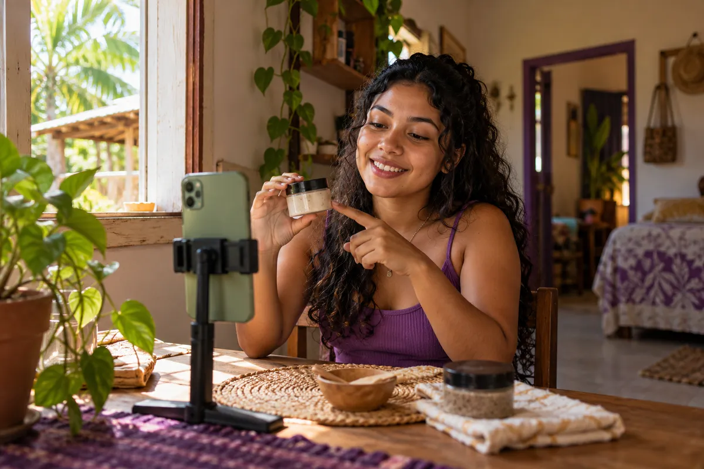
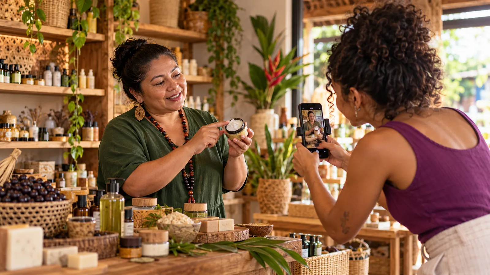

_Você não precisa ter milhões de seguidores, morar numa capital ou possuir uma câmera profissional para começar a desenvolver habilidades no mercado de conteúdo. E, para as marcas, entender a Creator Economy é descobrir outras formas de criar confiança e comunicar valor._

**Creator Economy, ou economia dos criadores, é o mercado em que pessoas transformam conhecimento, criatividade, conteúdo e relacionamento com públicos em trabalho, produtos, serviços e fontes de receita.** Nele atuam influenciadores, criadores de UGC, editores de vídeo, roteiristas, profissionais de social media, educadores e outros especialistas. As empresas participam desse mercado ao contratar essas habilidades, criar parcerias e desenvolver suas próprias comunidades.

Na Amazônia, essa economia oferece uma possibilidade especialmente importante: gerar oportunidades a partir das pessoas e dos conhecimentos que já existem no território. Os desafios de conexão, formação e acesso a equipamentos são reais. Mas não significam que quem vive em Altamira, Santarém, Marabá, Belém ou numa comunidade ribeirinha esteja automaticamente fora do mercado.

Ao longo deste artigo, você vai entender como a economia dos criadores funciona, conhecer **cases reais do Pará e projetos da Ousadia Marketing** e descobrir por onde começar, seja como profissional, seja como empreendedor que quer se comunicar melhor.

## Por que a Creator Economy importa para quem vive na Amazônia?

Em Altamira, uma esteticista aprende a produzir vídeos para apresentar os cosméticos com os quais trabalha. Numa comunidade ribeirinha, uma oficina coloca a câmera nas mãos de quem vive ali. Em Belém, uma empresa percebe que explicar um ingrediente amazônico de outro jeito pode ajudar novos consumidores a entender como usá-lo.

São experiências diferentes. Uma trata de conteúdo para marcas; outra, do direito de contar a própria história; a terceira, de posicionamento comercial. Mas as três apontam para a mesma pergunta: **quem participa do valor criado pela comunicação sobre a Amazônia?**

Durante muito tempo, a publicidade sobre a região circulou com imagens bonitas de rios e floresta, enquanto muitas pessoas que vivem nela tinham menos acesso aos meios de produção e distribuição dessas histórias. A internet não eliminou essa desigualdade, mas abriu novas possibilidades de trabalho, formação e autoria.

É por isso que falar de Creator Economy na Amazônia não deveria significar apenas ensinar alguém a ganhar seguidores. Também deveria significar formar profissionais, aproximar marcas de talentos locais e valorizar o conhecimento de quem está aqui.

<Secao tom="marfim" de="base">

## Como funciona a Creator Economy na prática?

Pense em uma pequena empresa de cosméticos. Para apresentar um produto, ela pode contratar uma influenciadora que converse com um público interessado em beleza. Pode também contratar uma pessoa para produzir vídeos de demonstração que serão publicados no perfil da própria empresa. Ou pode contar com alguém que organize calendário editorial, roteiros, edição e distribuição dos conteúdos.

Esses trabalhos pertencem ao mesmo ecossistema, mas **não são a mesma profissão**.

| Atuação | O que entrega | Precisa ter muitos seguidores? |
| --- | --- | --- |
| **Influenciador ou creator com audiência própria** | Conteúdo e acesso a uma comunidade que acompanha seu perfil. | Não necessariamente; a adequação e a confiança do público importam, mas a audiência costuma fazer parte da negociação. |
| **UGC Creator** | Vídeos e fotos contratados para uma marca utilizar em seus canais ou anúncios. | **Não.** O foco pode estar no portfólio, na qualidade do conteúdo e nos direitos de uso negociados. |
| **Social media e estrategista** | Planejamento, publicação, análise e organização da comunicação de uma empresa. | Não. O serviço é prestado à marca, e não à audiência pessoal do profissional. |
| **Roteirista, editor, fotógrafo ou designer** | Produção criativa e técnica de peças de comunicação. | Não. O diferencial é a competência demonstrada nas entregas. |
| **Educador ou especialista** | Cursos, consultorias, oficinas, conteúdos educativos e comunidades. | Não é obrigatório; reputação, clareza de proposta e capacidade de ajudar um público são essenciais. |

Uma pessoa pode exercer mais de uma dessas atividades. Uma revendedora pode aprender a criar vídeos para a marca. Um jovem que gosta de editar pode começar atendendo pequenos negócios. Uma cozinheira pode ensinar técnicas que conhece. E ninguém precisa transformar a própria vida privada em um programa diário para trabalhar com conteúdo.

Duas ideias ajudam a entender essa mudança. O pesquisador **Henry Jenkins**, em _Cultura da convergência_, descreve uma comunicação na qual o público deixa de ser apenas espectador e passa a participar da produção e circulação de histórias. Já **Kevin Kelly**, no ensaio _1,000 True Fans_, chama atenção para o valor de relações próximas e duradouras com uma comunidade. Seu modelo não é uma promessa de renda ou uma meta obrigatória de mil seguidores; é um lembrete de que **confiança e relevância não se medem apenas pelo tamanho de um perfil**.

### UGC e marketing de influência: qual é a diferença?

**UGC** é a sigla de _user-generated content_, ou conteúdo gerado por usuários. Originalmente, descreve conteúdos criados espontaneamente por consumidores. No mercado de publicidade, o termo também é usado para vídeos e fotos produzidos **sob contratação**, com linguagem próxima de uma experiência real de uso.

Quando uma marca contrata um **influenciador**, geralmente busca comunicação com o público que já acompanha aquele profissional. Quando contrata um **UGC Creator**, pode estar comprando principalmente a produção de um material para usar nos próprios canais, independentemente de quantas pessoas seguem o perfil de quem gravou.

Em ambos os casos, briefing, remuneração, transparência publicitária e direitos de imagem e de uso do conteúdo precisam ser combinados. Uma coisa não substitui automaticamente a outra.

### Creator Economy é a mesma coisa que economia criativa?

Não exatamente. **Economia criativa** é um campo mais amplo, que inclui atividades econômicas relacionadas à cultura, ao design, ao audiovisual, à música, à publicidade e a outros trabalhos baseados em criatividade e conhecimento. A **Creator Economy** é uma parte desse universo, especialmente ligada a criadores, plataformas digitais, comunidades e novas formas de distribuição e monetização.

Na Amazônia, os dois campos se encontram quando um projeto audiovisual, uma marca de bioeconomia, uma artista ou um pequeno negócio transforma conhecimento e produção criativa em trabalho remunerado, com participação justa de quem cria.

</Secao>

<Secao tom="verde" de="marfim">

## O mercado está crescendo? O que mostram os dados

O crescimento do consumo digital não significa que toda pessoa conectada consiga ganhar dinheiro criando conteúdo. Mas ajuda a entender por que empresas e profissionais passaram a prestar atenção nesse mercado.

### Quase todo mundo está conectado

Segundo a [PNAD Contínua TIC do IBGE, publicada em julho de 2026](https://agenciadenoticias.ibge.gov.br/agencia-noticias/2012-agencia-de-noticias/noticias/47408-proporcao-de-usuarios-da-internet-no-pais-ultrapassou-90-da-populacao-de-10-anos-ou-mais-em-2025), **89,7% das pessoas com 10 anos ou mais da Região Norte utilizaram a internet em 2025**. No Brasil, o índice foi de **90,5%**. Entre os usuários brasileiros, **84,9% utilizaram redes sociais** e **89,3% assistiram a vídeos**.

<Kpis>
  <Kpi valor="89,7%" rotulo="das pessoas do Norte usaram a internet" detalhe="10 anos ou mais, em 2025" />
  <Kpi valor="90,5%" rotulo="no Brasil como um todo" />
  <Kpi valor="84,9%" rotulo="dos usuários estão em redes sociais" />
  <Kpi valor="89,3%" rotulo="dos usuários assistiram a vídeos" />
</Kpis>

### Mas o acesso ainda é desigual

Os dados de acesso contam outra parte da história. A pesquisa [TIC Domicílios 2025, do Cetic.br](https://cetic.br/pt/tics/domicilios/2025/domicilios/A4/), informa que **83% dos domicílios do Norte tinham internet** e que [somente 25% tinham computador](https://cetic.br/pt/tics/domicilios/2025/domicilios/A1/), indicador que inclui computador de mesa, notebook ou tablet.

<GraficoBarras
  titulo="Domicílios da Região Norte (%)"
  dados={[
    { rotulo: "Com acesso à internet", valor: 83 },
    { rotulo: "Com computador, notebook ou tablet", valor: 25, alt: true },
  ]}
  max={100}
  sufixo="%"
  fonte="Cetic.br, TIC Domicílios 2025"
/>

Essas pesquisas usam metodologias e populações de referência diferentes: o percentual do IBGE citado acima trata de **pessoas**, enquanto os indicadores do Cetic.br tratam de **domicílios**. Não devem ser lidos como se fossem a mesma medida.

### O investimento das marcas cresce rápido

No mercado publicitário dos Estados Unidos, o [Interactive Advertising Bureau (IAB)](https://www.iab.com/news/creator-economy-ad-spend-to-reach-37-billion-in-2025-growing-4x-faster-than-total-media-industry-according-to-iab/) projetou **US$ 37 bilhões em investimento com criadores em 2025**, alta de 26% em relação a 2024. É um indicador **norte-americano de investimento publicitário**, não uma estimativa de renda dos criadores brasileiros ou do tamanho do mercado na Amazônia.

<Kpis>
  <Kpi valor="US$ 37 bi" rotulo="em investimento com criadores nos EUA" detalhe="projeção do IAB para 2025" />
  <Kpi valor="+26%" rotulo="em relação a 2024" />
</Kpis>

A leitura mais responsável desses dados é dupla: há uma transformação relevante no modo como pessoas consomem conteúdo e marcas se comunicam; ao mesmo tempo, existem barreiras materiais e profissionais que precisam ser enfrentadas para ampliar o acesso ao trabalho digital.

</Secao>

<Secao tom="marfim" de="verde">

## Cases reais da Creator Economy no Pará e na Amazônia

A teoria fica mais clara quando olhamos para experiências documentadas. Alguns exemplos abaixo são projetos da **Ousadia Marketing**, sediada em Altamira; outros são trajetórias e iniciativas independentes do Pará. Também incluímos casos de **posicionamento de marca e audiovisual**, sinalizados como tal, porque mostram como criadores e comunicação estratégica podem gerar valor, sem confundir todas essas atividades com campanhas de influência.

### 1. Ekilibre Amazônia e Ousadia Marketing: revendedoras também podem se tornar criadoras

Na Ekilibre Amazônia, marca de cosméticos naturais, a Ousadia trabalhou com uma pergunta bastante prática: **por que a comunicação do produto dependeria apenas de rostos contratados de fora, se as próprias revendedoras já conhecem suas características e as dúvidas dos clientes?**

O [Programa de Embaixadoras EKL, apresentado no portfólio da Ousadia](/portfolio), usou a formação em UGC para desenvolver a produção de conteúdo pelas próprias esteticistas naturalistas. No **START Creators do Clube Ekl**, realizado em **maio e junho de 2026**, a primeira turma reuniu **cinco embaixadoras de três estados**.

O projeto registrou práticas como **lives semanais, conteúdos publicados em colaboração com a marca e vendas on-line com cupons e comissão**, além da revenda presencial. A principal mudança descrita pela agência foi sair do modelo em que a revendedora apenas recebe uma peça pronta para um processo em que aprende a criar.

**O que um pequeno empreendedor aprende com esse case:** talvez o talento que sua marca precisa já esteja no atendimento, na equipe comercial, entre as revendedoras ou na própria comunidade de clientes. Formar essas pessoas pode fortalecer a comunicação, desde que haja orientação, respeito e condições adequadas para participar.

**O que um iniciante aprende:** conhecer bem um produto e aprender a demonstrá-lo é uma habilidade que pode ser desenvolvida, mesmo sem uma audiência expressiva.

_Limite da evidência:_ o portfólio informa atividades e participantes, mas não apresenta uma mensuração pública auditável de crescimento de faturamento causada pela campanha.

### 2. Escola Ousadia: aprender a gravar e se posicionar é parte do trabalho

É comum ouvir de quem está começando: “eu travo quando ligo a câmera”. Isso também acontece com pessoas experientes em vender, ensinar ou prestar serviços presencialmente.

Segundo o [portfólio da Escola Ousadia](/portfolio), foram realizadas **mais de 30 turmas presenciais entre 2020 e 2025**, em formações como **ABC do Marketing, Destrave e Social Media de Eventos**. O histórico da agência relata alunos que passaram a publicar trabalhos e alguns que seguiram atuando com social media e audiovisual na região.

O aprendizado é menos glamouroso, e mais útil, do que parece: **falar diante da câmera, estruturar uma ideia, escrever um roteiro e editar um vídeo são habilidades que se treinam**. Para quem não quer aparecer, também há caminhos nos bastidores.

A Ousadia não apresenta, nas fontes públicas consultadas para este artigo, uma taxa auditada de empregabilidade ou de aumento de renda dos participantes. O dado verificável aqui é a experiência de formação relatada pela instituição.

### 3. CREAX e Biorama: o território precisa ter voz, não ser apenas cenário

No [portfólio audiovisual da Ousadia](/portfolio), o trabalho **CREAX — Oficina de Fotografia** registra uma experiência em comunidades ribeirinhas: colocar a câmera nas mãos de moradores para que participem da produção das imagens sobre seu território.

A agência também apresenta um vídeo institucional realizado para a **Biorama**, sobre inovação, produção e saberes tradicionais, com captação em campo do viveiro ao produto.

Esses projetos **não são apresentados aqui como prova de renda gerada a novos creators**. Mostram algo diferente: há demanda por documentação audiovisual, narrativa de origem e comunicação ligada à [bioeconomia](/conteudo/bioeconomia-o-que-e), e essa produção precisa considerar autorização de imagem, contexto, autoria e participação de quem vive na região.

**Para uma marca, a lição é simples:** a floresta não pode ser apenas um fundo bonito. Uma comunicação responsável mostra as pessoas, respeita seus conhecimentos e deixa claro quem participa do valor produzido.

### 4. Fundação CERTI e Jornada Amazônia: formação de embaixadores para falar de bioeconomia

Outro projeto relatado no [portfólio da Ousadia](/portfolio) é a formação de embaixadores do **Programa Gênese — Jornada Amazônia**, da Fundação CERTI, voltada à criação de conteúdo sobre **bioeconomia, empreendedorismo e inovação**, em atividades realizadas entre **agosto e setembro de 2025**, no contexto da preparação para a COP30.

Esse caso mostra como um programa de desenvolvimento pode incluir comunicação no processo de formação: não apenas realizar uma atividade, mas preparar pessoas para apresentar ideias, projetos e histórias relacionadas a ela.

**Para quem deseja trabalhar no digital**, iniciativas assim ajudam a enxergar oportunidades em organizações sociais, projetos de formação, eventos e negócios ligados à economia criativa, além da publicidade tradicional. O material público consultado não permite afirmar remuneração ou resultados comerciais individuais dos embaixadores.

### 5. Juliana Araújo: criar conteúdo a partir da Transamazônica

A criadora e mentora **Juliana Araújo** apresenta sua trajetória profissional a partir de **Altamira, no Pará**. Em seu [perfil público no LinkedIn](https://br.linkedin.com/in/juliana-ara%C3%BAjo-98603a236), descreve o trabalho como criadora de conteúdo na Transamazônica e o interesse em conectar histórias e oportunidades da Amazônia a marcas e iniciativas de comunicação. Ela também registra sua participação como embaixadora do Programa Gênese, durante a COP30.

Sua experiência ajuda a tornar o mercado menos abstrato para quem mora fora de uma capital. **A origem não precisa ser escondida para construir um posicionamento profissional**: ela pode fazer parte do repertório, da linguagem e dos temas que a pessoa escolhe trabalhar. Isso não significa que todos terão os mesmos contratos ou resultados; cada trajetória depende de formação, portfólio, relações profissionais e condições concretas de mercado.

### 6. Visite o Pará: conteúdo territorial pode abrir parcerias comerciais

O criador **Rômulo Dias**, responsável pelo **Visite o Pará**, é um exemplo paraense de conteúdo conectado a turismo e identidade regional. Em [reportagem publicada pelo Sebrae/PA em 28 de maio de 2025](https://pa.agenciasebrae.com.br/cultura-empreendedora/creators-paraenses-compartilham-experiencias-empreendedoras-em-bate-papo-na-semana-do-mei-em-belem/), ele relatou ter conhecido os **144 municípios do Pará** e desenvolvido parcerias comerciais, incluindo com uma plataforma de hospedagens.

É importante fazer uma distinção: o Visite o Pará já tinha **audiência grande** na ocasião da reportagem, portanto **não deve ser apresentado como prova de que qualquer perfil pequeno fechará contratos**. O caso demonstra a conexão possível entre conteúdo regional e setores como turismo, hotelaria e comércio.

### 7. Manioca, em Belém: um case de posicionamento que toda marca deveria estudar

A **Manioca**, empresa paraense de alimentos da biodiversidade, oferece um aprendizado complementar. É um **case de posicionamento de marca**, não um relato de contratação de influenciadores.

De acordo com reportagem do [Reset, publicada em abril e atualizada em julho de 2026](https://capitalreset.uol.com.br/amazonia/bioeconomia/shoyu-amazonico-startup-aproxima-tucupi-do-paladar-dos-brasileiros/), a empresa passou a apresentar o tucupi preto como **“shoyu amazônico”** para tornar seu uso mais compreensível fora da região. A reportagem informa um **aumento de 35% nas vendas** após a mudança. Não divulga faturamento nem isola todos os fatores que contribuíram para o resultado.

O caso ajuda a responder uma pergunta frequente de empresários: **por que meu produto é bom, mas as pessoas não entendem seu valor?** Às vezes, o problema não é falta de publicidade. É falta de clareza sobre o que o produto faz, para quem serve e como entra na vida do consumidor.

</Secao>

<Secao tom="roxo" de="marfim">

## Como começar a trabalhar com Creator Economy sem muitos seguidores?

Você não precisa esperar o perfil crescer para **começar a aprender e montar um portfólio**. Também não precisa comprar uma câmera antes de saber o que quer produzir. Isso não significa, porém, que o mercado seja fácil ou que uma primeira contratação esteja garantida.

Um caminho de entrada é escolher uma habilidade e transformá-la em uma entrega concreta:

1. **Escolha o tipo de trabalho que faz sentido para você.** Prefere gravar demonstrações de produtos, escrever roteiros, editar vídeos ou planejar redes sociais? É possível começar por uma única frente.
2. **Observe um assunto que você conhece.** Pode ser beleza, plantas, alimentação, turismo, tecnologia ou comércio local. Conhecer o cotidiano do público ajuda a criar conteúdos mais úteis.
3. **Use o celular para produzir três exemplos.** Grave perto de uma janela, procure reduzir ruídos e experimente vídeos curtos de demonstração, explicação e resposta a uma dúvida comum.
4. **Monte um portfólio honesto.** Identifique vídeos de teste como **projetos autorais sem vínculo com a marca**. Não invente trabalhos contratados nem resultados.
5. **Aprenda a fazer uma proposta.** Explique qual problema você pode ajudar a resolver, o que vai entregar, em quanto tempo e como será o uso do material.
6. **Busque oportunidades sem depender de viralização.** Converse com negócios compatíveis com seu repertório, acompanhe projetos locais e desenvolva sua técnica com feedback.

### “Eu tenho vergonha de gravar.”

Você não precisa começar falando diretamente para a câmera. Experimente filmar as mãos usando um produto, mostrar um processo e narrar por cima. Outra possibilidade é atuar com roteiro, edição ou estratégia, que não exigem exposição pessoal. A confiança costuma crescer com treino e repertório, não com frases prontas sobre coragem.

### “Eu moro no interior e a internet é ruim.”

Planeje etapas que podem ser feitas sem conexão contínua: roteiro, gravação e parte da edição. Reserve os momentos de melhor sinal para transferir arquivos e falar com clientes. Combine prazos possíveis e custos de deslocamento quando o trabalho exigir presença. A dificuldade de infraestrutura existe, e precisa entrar na negociação profissional, não ser fingida de inexistente.

### “Só tenho meu celular. Meu vídeo pode servir para uma marca?”

Pode, dependendo do briefing, do produto, da qualidade de áudio e imagem e da finalidade do conteúdo. Um vídeo claro, bem iluminado e com demonstração honesta pode atender a determinadas demandas. Outras campanhas exigirão equipamento, equipe ou produção mais complexa. **Começar com o que você tem não é o mesmo que prometer qualquer resultado com qualquer ferramenta.**

Se quiser conhecer uma trilha de formação, a [Escola Ousadia apresenta uma formação para UGC Creators](/escola/ugc-creator) voltada ao desenvolvimento de portfólio, posicionamento e habilidades de produção para marcas.

</Secao>

<Secao tom="marfim" de="roxo">

## Como pequenas empresas podem usar a Creator Economy para vender e se posicionar melhor?

Talvez você tenha uma loja, um restaurante, uma marca de cosméticos, uma pousada ou uma empresa familiar e esteja pensando: “isso é interessante, mas o que muda no meu negócio?”.

A primeira mudança é entender que **publicar nas redes sociais não é sinônimo de ter posicionamento**. O cliente precisa perceber por que sua empresa existe, para quem seu produto serve e o que a diferencia.

Uma floricultura de Altamira, por exemplo, pode produzir vídeos educativos sobre cuidados com as plantas. Um restaurante pode explicar seus ingredientes e mostrar a preparação de um prato. Uma empresa de bioeconomia pode apresentar a origem do produto e a participação das pessoas que o produzem. Esses são **exemplos de aplicação**, não campanhas reais atribuídas a esses negócios.

O caminho começa com três perguntas: **qual problema de comunicação temos, com quem queremos conversar e o que esperamos que aconteça depois de cada conteúdo?**

Se a empresa precisa alcançar uma comunidade específica, uma parceria com um creator que já fala com esse público pode fazer sentido. Se precisa de materiais para o próprio perfil ou para anúncios, a contratação de UGC pode ser mais adequada. Se não consegue manter uma comunicação coerente, talvez o primeiro investimento deva ser planejamento e estratégia.

### Como contratar um creator de perfil pequeno com profissionalismo?

Perfis menores podem ser parceiros valiosos quando o conteúdo, a linguagem e o público combinam com a marca. Mas **baixo número de seguidores não deve ser confundido com trabalho gratuito**.

Antes de fechar uma parceria, defina o objetivo, solicite exemplos de trabalhos, combine formatos e quantidade de entregas, remuneração, prazo, revisões e utilização do material. Esclareça especialmente se a marca poderá usar o vídeo em anúncios, por quanto tempo e em quais canais. Quando houver publicidade, a parceria deve ser identificada de forma transparente.

Para medir resultados, evite olhar apenas para curtidas. Dependendo do objetivo, acompanhe **mensagens qualificadas, visitas, pedidos de orçamento, cliques ou vendas identificáveis**. Um projeto pequeno, bem acompanhado, pode ensinar mais do que muitas publicações sem direção.

<Destaque titulo="O que a empresa ganha de verdade">
  O maior benefício para a empresa não é “ter alguém postando”. É construir uma comunicação que ajude o cliente a compreender e confiar na marca.
</Destaque>

</Secao>

<Secao tom="verde" de="marfim">

## A Amazônia não precisa ser cenário: pode ser autora desse mercado

Existe espaço na Creator Economy para quem fala de floresta e bioeconomia. Mas também para quem cria sobre maquiagem, futebol, tecnologia, maternidade, culinária, educação ou a rotina de um pequeno negócio.

Nem toda pessoa amazônida precisa se apresentar como representante da Amazônia inteira. E nenhuma comunidade deveria aparecer apenas como imagem de campanha enquanto o trabalho, a autoria e a remuneração ficam sempre em outro lugar.

É por isso que a [história da Ousadia Marketing](/sobre) está ligada à formação de profissionais e empreendedores a partir do próprio território. Sua proposta parte de Altamira, no Pará, para unir comunicação, criatividade, estratégia e desenvolvimento de talentos regionais.

A transformação não depende de prometer que todo mundo vai viver de vídeos. Depende de criar condições para que mais pessoas possam **aprender, oferecer serviços, negociar com dignidade e construir trajetórias possíveis**.

</Secao>

<Secao tom="marfim" de="verde">

## Perguntas frequentes sobre Creator Economy

<Duvida pergunta="O que é Creator Economy, em palavras simples?">
  É a **economia dos criadores**: atividades em que pessoas utilizam criatividade, conhecimento, conteúdo e comunidades para oferecer serviços, produtos e experiências. Inclui influenciadores, UGC Creators, profissionais de audiovisual, social medias, educadores e outros especialistas. Não se limita a celebridades ou à publicidade em redes sociais.
</Duvida>

<Duvida pergunta="Qual é a diferença entre creator e influenciador digital?">
  **Creator** é um termo amplo para quem produz conteúdo. **Influenciador** costuma designar quem constrói uma audiência própria capaz de influenciar opiniões e escolhas. Um influenciador também pode ser creator, mas nem todo creator trabalha com influência: alguns produzem vídeos para marcas, editam ou escrevem roteiros sem depender de seguidores pessoais.
</Duvida>

<Duvida pergunta="Dá para ganhar dinheiro com Creator Economy sem seguidores?">
  **É possível prestar serviços sem uma audiência grande**, especialmente em UGC, edição, roteiro e social media. Mas ganhar dinheiro depende de conseguir clientes, entregar qualidade, negociar e manter uma atividade profissional. Poucos seguidores não impedem o início; também não garantem contratos ou renda.
</Duvida>

<Duvida pergunta="O que é UGC e por que uma empresa contrataria esse profissional?">
  UGC é conteúdo gerado por usuários; no mercado profissional, a expressão também descreve vídeos e fotos produzidos por criadores para marcas com linguagem próxima da experiência de consumo. Uma empresa pode contratar esse serviço para demonstrar produtos, responder dúvidas e obter materiais para seus canais e anúncios, sem necessariamente comprar divulgação no perfil do creator.
</Duvida>

<Duvida pergunta="Preciso ter câmera profissional para começar como criador?">
  **Não necessariamente.** Um celular pode ser suficiente para praticar roteiro, luz, enquadramento, áudio e edição e para desenvolver um primeiro portfólio. A exigência de equipamento depende do tipo de projeto e do padrão de entrega combinado com cada cliente.
</Duvida>

<Duvida pergunta="Quem mora no interior do Pará pode trabalhar com criação de conteúdo?">
  **Sim.** Há possibilidades em produção de conteúdo para empresas, cobertura de eventos, audiovisual, UGC e gestão de redes sociais. O conhecimento sobre a cultura e os negócios locais pode ser um diferencial. Ao mesmo tempo, acesso à internet, transporte, formação e prospecção comercial precisam entrar no planejamento.
</Duvida>

<Duvida pergunta="Como uma pequena empresa deve escolher entre influenciador, UGC Creator e social media?">
  Comece pelo **objetivo de comunicação**. Para alcançar uma comunidade, avalie um influenciador cujo público faça sentido. Para receber vídeos e fotos destinados aos canais da marca, considere um UGC Creator. Para organizar estratégia, calendário e acompanhamento, procure um social media ou estrategista. Em alguns projetos, as funções são complementares.
</Duvida>

<Duvida pergunta="Como saber se minha empresa está preparada para trabalhar com creators?">
  Observe se a marca tem **público definido, posicionamento claro, objetivos de marketing, orçamento e capacidade de acompanhar resultados**. Se essas respostas ainda são vagas, um diagnóstico de maturidade digital pode ajudar a identificar o que organizar antes de investir em novas campanhas.
</Duvida>

</Secao>

<Secao tom="roxo" de="marfim">

## Empresário: você usa o marketing a seu favor ou apenas publica nas redes?

Ter Instagram, WhatsApp e um logotipo não significa, por si só, que sua empresa tenha um posicionamento forte. Antes de contratar creators, impulsionar posts ou produzir mais vídeos, vale perguntar:

**Seu cliente entende o que diferencia sua marca? Seus conteúdos respondem a dúvidas reais? Você sabe quais ações trazem conversas e vendas? E sua equipe consegue explicar o valor daquilo que oferece?**

Não é preciso ter todas essas respostas prontas. Mas é importante descobrir onde sua empresa está e qual deveria ser o próximo passo.

A **Ousadia Marketing** criou o **Diagnóstico de Maturidade Digital**, com **12 perguntas e duração estimada de quatro minutos**, para avaliar dimensões como posicionamento, conteúdo, influência, planejamento e criação. A ferramenta apresenta um resultado personalizado conforme o momento de quem responde.

**[Faça o Diagnóstico de Maturidade Digital da Ousadia Marketing](/diagnostico)**

Porque, antes de perguntar “quantos seguidores precisamos conquistar?”, talvez a pergunta mais importante seja outra: **por que alguém deveria escolher a nossa marca?**

<CtaBloco contexto="agencia" label="Conversar sobre a comunicação da sua marca">
  Quer trabalhar com creators ou formar a sua própria equipe de conteúdo? Fale com a gente.
</CtaBloco>

</Secao>

## Fontes e referências

Os dados e os projetos citados neste artigo foram consultados nas seguintes fontes. Nas experiências realizadas pela Ousadia, a fonte é o **portfólio institucional da própria agência**; quando não havia métricas públicas auditáveis, o texto não atribuiu crescimento de vendas, renda ou empregabilidade ao projeto.

- **IBGE (2026).** [PNAD Contínua TIC: proporção de pessoas de 10 anos ou mais que utilizaram a internet em 2025](https://agenciadenoticias.ibge.gov.br/agencia-noticias/2012-agencia-de-noticias/noticias/47408-proporcao-de-usuarios-da-internet-no-pais-ultrapassou-90-da-populacao-de-10-anos-ou-mais-em-2025). Divulgação em 2 jul. 2026.
- **Cetic.br/NIC.br.** [TIC Domicílios 2025: domicílios com acesso à internet (A4)](https://cetic.br/pt/tics/domicilios/2025/domicilios/A4/) e [domicílios com computador (A1)](https://cetic.br/pt/tics/domicilios/2025/domicilios/A1/).
- **IAB (2025).** [Creator Economy Ad Spend to Reach $37 Billion in 2025](https://www.iab.com/news/creator-economy-ad-spend-to-reach-37-billion-in-2025-growing-4x-faster-than-total-media-industry-according-to-iab/). Projeção de investimento publicitário nos Estados Unidos.
- **Ousadia Marketing.** [Portfólio: Ekilibre Amazônia, Programa de Embaixadoras EKL, Escola Ousadia, CREAX, Biorama e Fundação CERTI/Jornada Amazônia](/portfolio). Relatos institucionais dos projetos.
- **Ousadia Marketing.** [A história da agência-escola](/sobre) e [Escola Ousadia](/escola).
- **Juliana Araújo.** [Perfil profissional público no LinkedIn](https://br.linkedin.com/in/juliana-ara%C3%BAjo-98603a236). Apresentação profissional e relatos de participação no Programa Gênese.
- **Sebrae/PA (2025).** [Creators paraenses compartilham experiências empreendedoras na Semana do MEI](https://pa.agenciasebrae.com.br/cultura-empreendedora/creators-paraenses-compartilham-experiencias-empreendedoras-em-bate-papo-na-semana-do-mei-em-belem/). Publicado em 28 maio 2025.
- **Reset (2026).** [Shoyu amazônico: startup aproxima tucupi do paladar dos brasileiros](https://capitalreset.uol.com.br/amazonia/bioeconomia/shoyu-amazonico-startup-aproxima-tucupi-do-paladar-dos-brasileiros/). Publicado em 7 abr. 2026; atualizado em 15 jul. 2026.
- **Kelly, Kevin (2008).** [1,000 True Fans](https://kk.org/thetechnium/1000-true-fans/). _The Technium_. Leitura complementar sobre o valor de comunidades engajadas.
- **Jenkins, Henry (2009).** _Cultura da convergência_. São Paulo: Aleph. Referência teórica sobre participação de públicos e produção cultural.

_Revisão editorial: 22 de outubro de 2026. Os casos de posicionamento, formação e audiovisual foram distinguidos de campanhas comerciais de creator marketing para não atribuir resultados sem comprovação._
